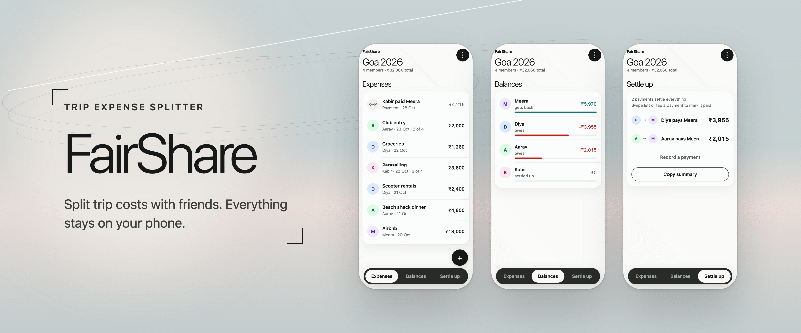
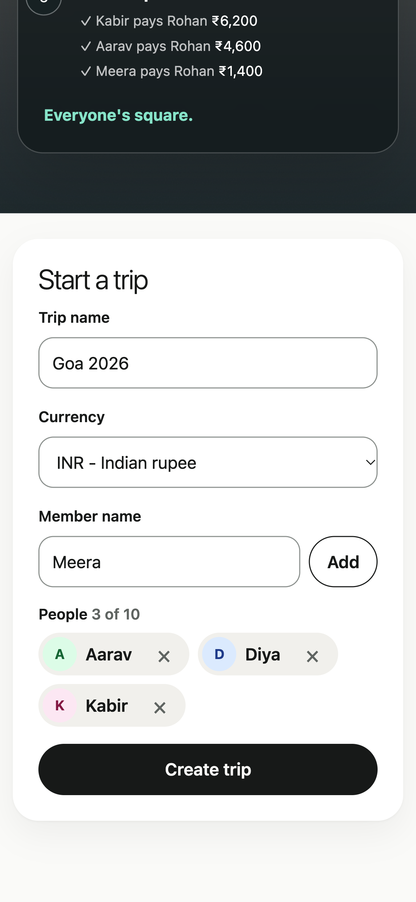
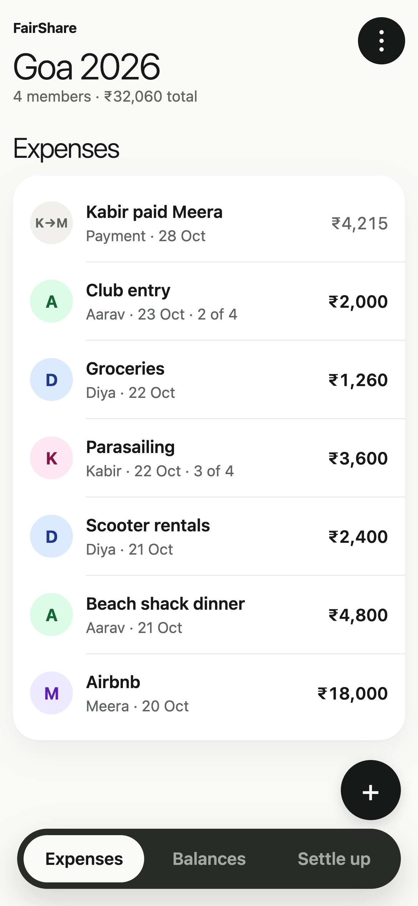
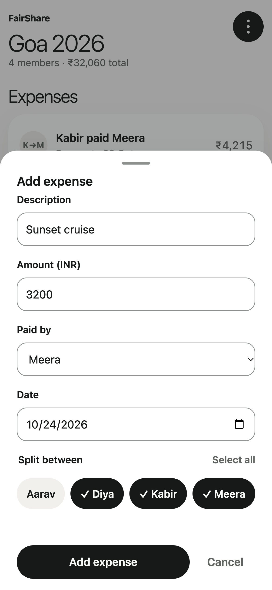
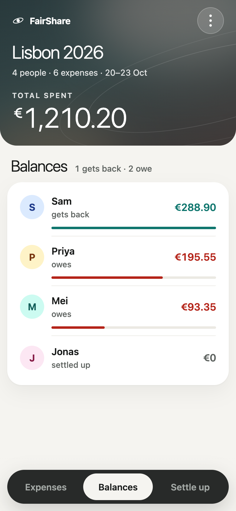
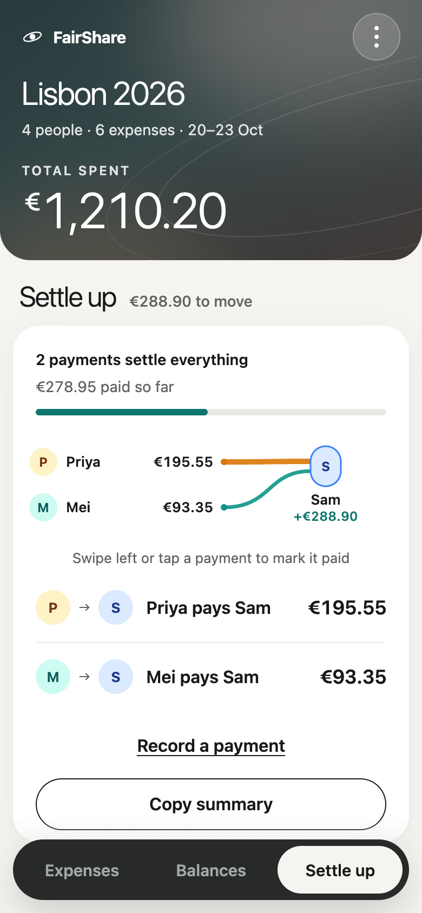
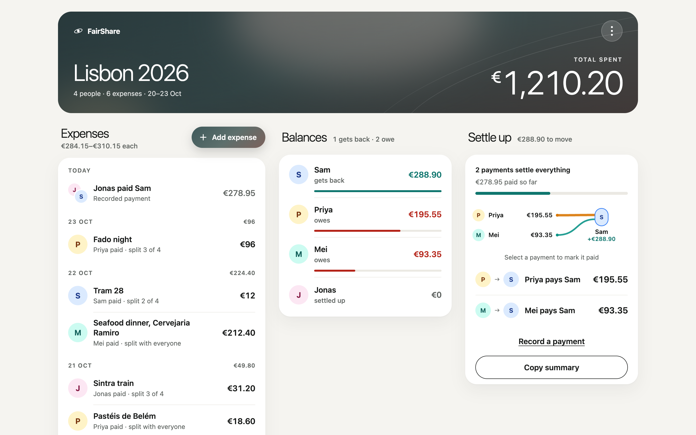
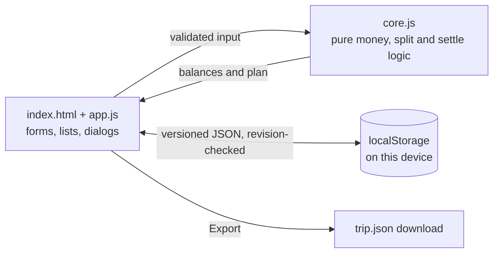

<p align="center">
  <picture>
    <source media="(prefers-color-scheme: dark)" srcset="docs/images/hero-dark.png">
    
  </picture>
</p>

<p align="center">
  <a href="https://ianmolagarwal.github.io/fairshare/"></a>
  
  
  
  <a href="LICENSE"></a>
</p>

FairShare splits the cost of a trip between friends and tells you who owes whom. You add the people and the expenses as they happen, and it keeps a running balance for everyone plus the shortest list of payments that settles the trip. There is no backend and no account: everything lives in your browser, on your phone.

**One of the top 10 builders.** FairShare was named one of the 10 runners-up, by Builder score, in HackerEarth's [AI Innovation Arena](https://vibecodearena.ai/ai-innovation-arena) on VibeCode Arena (September to October 2026, 1,726 participants). Its final submission scored 100 on every axis of the arena's automated evaluation: security, code quality, correctness, performance and accessibility.

## Try it in 30 seconds

Open **[ianmolagarwal.github.io/fairshare](https://ianmolagarwal.github.io/fairshare/)** on your phone, then:

1. name the trip, pick a currency and add two to ten people, then tap **Create trip**
2. tap **+** and add a few expenses: who paid, how much, and who it was for
3. open **Balances** to see who is up and who is down, then **Settle up** for the payments that clear it

Nothing you type leaves the page. Close the tab and come back later: the trip is still there.

## The problem

Group trips run on one person's card at a time. Someone books the stay, someone else pays for dinner, a third person covers fuel, and by day three nobody knows who is ahead. The usual fixes are a spreadsheet that one person maintains, or an app that wants everyone to sign up before you can split a pizza.

FairShare is the version you can open in a browser tab on the beach. One person keeps the trip on their phone, the maths is exact to the last paisa, and at the end it hands you a short list of who pays whom.

## What you get

<p align="center">
  <picture><source media="(prefers-color-scheme: dark)" srcset="docs/images/screen-setup-dark.png"></picture>
  <picture><source media="(prefers-color-scheme: dark)" srcset="docs/images/screen-expenses-dark.png"></picture>
  <picture><source media="(prefers-color-scheme: dark)" srcset="docs/images/screen-add-expense-dark.png"></picture>
  <picture><source media="(prefers-color-scheme: dark)" srcset="docs/images/screen-balances-dark.png"></picture>
</p>
<p align="center">
  <picture><source media="(prefers-color-scheme: dark)" srcset="docs/images/screen-settle-dark.png"></picture>
  <picture><source media="(prefers-color-scheme: dark)" srcset="docs/images/desktop-dashboard-dark.png"></picture>
</p>
<p align="center"><sub>Screenshots use demo data. Aarav, Diya, Kabir and Meera are not real people, and did not actually go parasailing.</sub></p>

- trips of 2 to 10 people, with names checked for blanks and duplicates (ignoring case)
- expenses split equally between everyone or only the people who were there
- 12 currencies: INR, USD, EUR, GBP, AED, SGD, THB, JPY, AUD, CAD, IDR and LKR, each with its own decimal places (yen has none)
- live balances in plain words: **gets back**, **owes** or **settled**
- a settle-up plan of at most one payment fewer than the number of people; tap or swipe a payment to mark it paid, with **Undo**
- ad-hoc payments between friends, which move balances without inflating the trip total
- edit any expense or payment later; deletes come with a 10-second **Undo**
- **Copy summary** puts the plan on your clipboard as plain text, ready for the group chat
- a newest-first expense list on the phone, and a desktop dashboard that shows everything at once
- light and dark themes that follow your system, reduced motion when you ask for it
- export the whole trip as JSON, for your records or a spreadsheet
- a warning instead of silent data loss when the same trip is open in two tabs

## How it works

Every amount is stored as an integer number of minor units (paise for rupees, cents for dollars), so there is no floating-point money anywhere. A member's balance is what they paid minus their share of the expenses they were part of, adjusted for payments they recorded.

**Why the leftover paisa goes to the first person.** ₹100 between three people is ₹33.33 each with one paisa left over. FairShare gives that paisa to the first participant in trip order, so the shares are ₹33.34, ₹33.33 and ₹33.33 and the balances always add up to exactly zero.

**Why the plan is short.** The settle-up pass repeatedly pairs the person who owes the most with the person who is owed the most, and moves the smaller of the two amounts. Each step clears at least one person, so a trip of *n* people needs at most *n* − 1 payments.

A worked example, with the demo trip from the screenshots before anyone has paid anyone back:

| Expense | Paid by | Split between | Amount |
|---|---|---|---:|
| Beach shack dinner | Aarav | everyone | ₹4,800 |
| Scooter rentals | Diya | everyone | ₹2,400 |
| Parasailing | Kabir | Aarav, Kabir, Meera | ₹3,600 |
| Airbnb | Meera | everyone | ₹18,000 |
| Groceries | Diya | everyone | ₹1,260 |
| Club entry | Aarav | Aarav, Diya | ₹2,000 |

| Member | Balance | Settle up |
|---|---:|---|
| Aarav | owes ₹2,015 | pays Meera ₹2,015 |
| Diya | owes ₹3,955 | pays Meera ₹3,955 |
| Kabir | owes ₹4,215 | pays Meera ₹4,215 |
| Meera | gets back **₹10,185** | receives three payments |

Four people, three payments, and the balances sum to zero. In the screenshots Kabir has already paid Meera, so the plan is down to two. These numbers come straight from `computeBalances` and `computeSettlements` in [`core.js`](core.js).

## Architecture



The app is four static files and no runtime dependencies. [`core.js`](core.js) holds every rule that touches money (parsing, splitting, balances, the settle plan, validation and schema migration) as pure functions with no DOM access, which is why most of the tests can run in plain Node. [`app.js`](app.js) renders the screens and wires the events. Saved trips carry a schema version and a revision number: older saves are migrated on load, and a save that would overwrite a newer copy from another tab is stopped and shown as a conflict.

For local development, [`server.js`](server.js) is a small static server that only serves an allowlist of four files, stamps each asset URL with a content hash, and sends a strict Content Security Policy. The GitHub Pages build does the same hashing at build time and puts the policy in a `<meta>` tag.

## Privacy

- **No backend.** There is no server-side code and no database. The live site is static files on GitHub Pages.
- **No accounts, analytics, tracking or ads.** The page makes no network requests after it loads.
- **Data stays on your device.** Trips are kept in this browser's `localStorage` and nowhere else. Clearing site data deletes them, so export a trip you care about.
- **You can read it.** About 3,300 lines of plain JavaScript, no build step for the app itself, no minified bundles.

> **One phone, one copy.** Because nothing syncs, the trip lives on whichever device created it. Copy the summary into the group chat (or share the exported JSON) at the end.

## Quality

- 140 tests on Node's built-in runner: unit tests for the money logic, jsdom smoke tests for the UI, and integration tests for the dev server
- ESLint with zero warnings, run in CI on Node 22 and 24 along with the tests and the build
- 100/100 on the AI Innovation Arena's automated evaluation (security, code quality, correctness, performance, accessibility)
- Lighthouse 100 for accessibility, best practices and SEO on mobile and desktop
- keyboard navigation, visible focus, screen-reader labels on every control and WCAG 2.2 AA-sized targets

<details>
<summary><b>Lighthouse</b></summary>
<br>

Lighthouse 12.8, local build, 28 October 2026. Mobile uses simulated throttling.

| | Performance | Accessibility | Best practices | SEO |
|---|---:|---:|---:|---:|
| Mobile | 99 | 100 | 100 | 100 |
| Desktop | 100 | 100 | 100 | 100 |

Largest contentful paint is 1.8 s on mobile and 0.4 s on desktop, with 0 ms of blocking time and no layout shift.

</details>

## Develop

<details>
<summary><b>Run it locally</b></summary>
<br>

You need Node.js 22 or newer for the dev tools (the app itself only needs a browser). The app has no runtime dependencies; `npm ci` installs the dev tools (ESLint and jsdom) only.

```sh
git clone https://github.com/iAnmolAgarwal/fairshare.git
cd fairshare
npm ci              # dev tools only
npm start           # http://localhost:5000, override with PORT
npm test            # unit, UI smoke and server tests
npm run lint        # ESLint, zero warnings
npm run build       # static site in dist/, as deployed to GitHub Pages
```

</details>

<details>
<summary><b>Project layout</b></summary>
<br>

```
.
├── index.html          # app shell and markup
├── app.js              # UI: rendering, events, storage
├── core.js             # pure logic: money, splits, balances, settle plan
├── styles.css          # light and dark themes
├── server.js           # allowlisted static dev server with CSP
├── scripts/
│   ├── assets.js       # asset hashing and CSP, shared by server and build
│   └── build.js        # static build for GitHub Pages
├── test/               # node:test suites
└── docs/images/        # README images
```

</details>

## Credits

Built by Anmol Agarwal ([@iAnmolAgarwal](https://github.com/iAnmolAgarwal)) for HackerEarth's AI Innovation Arena on [VibeCode Arena](https://vibecodearena.ai), where the app was written turn by turn through the arena's model with a human steering every turn. It started life as SplitSafar and was renamed FairShare along the way. The full history is in [CHANGELOG.md](CHANGELOG.md).

## License

[MIT](LICENSE).
